# CREDIT CARD FRAUD DETECTION USING MACHINE LEARNING AND BIG DATA ANALYTICS

---

### **A PROJECT REPORT**
*Submitted in partial fulfillment of the requirements for the degree of*  
**BACHELOR OF TECHNOLOGY IN DATA SCIENCE / COMPUTER SCIENCE & ENGINEERING**

**Academic Year**: 2025 – 2026  
**Submitted By**:
- **Candidate Name**: [Student Name Placeholder] (Roll No: [Roll Number])
- **Department**: Department of Data Science / Computer Science & Engineering
- **Institution**: [College / University Name Placeholder]

**Under the Guidance of**:
- **Project Supervisor / Guide**: [Internal Guide Name, Designation]
- **Head of the Department**: [HOD Name, Designation]

---

## TABLE OF CONTENTS
1. [Abstract](#1-abstract)
2. [Introduction](#2-introduction)
3. [Problem Statement](#3-problem-statement)
4. [Project Objectives](#4-project-objectives)
5. [Existing System & Its Limitations](#5-existing-system--its-limitations)
6. [Proposed System Architecture](#6-proposed-system-architecture)
7. [Data Flow Diagrams (DFDs) & System Flowchart](#7-data-flow-diagrams-dfds--system-flowchart)
8. [Hardware & Software Requirements](#8-hardware--software-requirements)
9. [Dataset Description & Inspection](#9-dataset-description--inspection)
10. [Data Preprocessing & Imbalance Mitigation](#10-data-preprocessing--imbalance-mitigation)
11. [Exploratory Data Analysis (EDA)](#11-exploratory-data-analysis-eda)
12. [Random Forest Algorithm & Theoretical Foundations](#12-random-forest-algorithm--theoretical-foundations)
13. [Model Training & Evaluation Methodology](#13-model-training--evaluation-methodology)
14. [Big Data Analytics Pipeline (Hadoop & PySpark)](#14-big-data-analytics-pipeline-hadoop--pyspark)
15. [Interactive Streamlit Web Dashboard](#15-interactive-streamlit-web-dashboard)
16. [Experimental Results & Comparative Analysis](#16-experimental-results--comparative-analysis)
17. [Discussion of Results](#17-discussion-of-results)
18. [Project Limitations](#18-project-limitations)
19. [Future Enhancements](#19-future-enhancements)
20. [Conclusion](#20-conclusion)
21. [References](#21-references)

---

## 1. Abstract
The exponential growth of digital financial ecosystems and cashless commerce has precipitated a parallel surge in sophisticated, unauthorized credit card fraud. Detecting fraudulent activities is inherently complicated due to extreme class imbalance (where fraudulent events represent less than 0.2% of total transaction volume) and the evolving tactics used by fraudsters to bypass static security rules. 

This project delivers a hybrid, production-grade fraud detection system that integrates **Cost-Sensitive Random Forest Machine Learning** with **Distributed Big Data Analytics (Apache Spark and Hadoop HDFS)**. Implemented across both **R (Caret / dplyr / ggplot2)** for academic rigor and **Python (Scikit-Learn / PySpark / Streamlit)** for enterprise operationalization, the system achieves **99.937% accuracy**, **81.00% precision**, **82.65% recall**, an **F1-Score of 0.8182**, and a **PR-AUC of 0.8418** on a strictly held-out test split of 56,962 transactions. The architecture reduces false positive alarms by **98.6%** compared to standard linear baselines, preserving cardholder trust while providing an interactive Streamlit dashboard for real-time risk scoring, batch analysis, and fraud monitoring.

---

## 2. Introduction
In modern banking networks, billions of transactions are processed daily. A small fraction of a percent represents unauthorized compromises such as identity theft, card-not-present (CNP) fraud, and credential skimming. Even tiny fractional loss rates aggregate to billions of dollars annually.

Historically, financial institutions relied on manual inspections and deterministic rule engines (e.g., flagging transactions exceeding a fixed dollar threshold or originating from high-risk IP addresses). However, static rules present significant drawbacks:
- They fail to detect novel attack patterns.
- They generate high volumes of **False Positives (Type I errors)**, frustrating legitimate consumers and causing costly transaction abandonment.
- They incur unacceptable latency in high-throughput payment rails.

Machine learning offers an automated, data-driven alternative by learning non-linear, multidimensional decision boundaries from historical transaction vectors. This project addresses the core challenge of credit card fraud detection by designing a balanced, reproducible architecture that bridges exploratory statistical modeling in R with distributed streaming analytics in Apache Spark.

---

## 3. Problem Statement
Given a continuous stream of credit card transactions $X = \{x_1, x_2, \dots, x_p\}$, determine whether each transaction belongs to:
- **Class 0 (Legitimate)**: Non-fraudulent transaction authorized by the genuine cardholder.
- **Class 1 (Fraudulent)**: Unauthorized or suspicious activity requiring immediate intervention.

The operational objective is to maximize **Recall** (catching real frauds) while maintaining high **Precision** (minimizing false alarms), subject to severe real-world constraints:
1. **Extreme Imbalance**: Only 492 out of 284,807 transactions (0.1727%) are fraudulent.
2. **Data Leakage Risk**: Temporal dependencies and scaling parameters must never leak from test to training sets.
3. **Scalability**: The data pipeline must process millions of records through distributed data structures.

---

## 4. Project Objectives
1. **Dataset Ingestion & Audit**: Programmatically ingest and inspect the benchmark Kaggle/ULB dataset, validating schema, missing values, and duplicate instances.
2. **Leak-Free Preprocessing**: Implement a robust scaling pipeline for unscaled features (`Time` and `Amount`) fitted strictly on training data, combined with stratified partitioning.
3. **Imbalance Mitigation**: Apply cost-sensitive loss weighting ($w_j = \frac{n}{k \cdot n_j}$) to penalize false negatives without distorting test class distributions.
4. **Ensemble Classification**: Train and tune a Random Forest classifier (100 trees, maximum depth 15) to uncover non-linear interactions across PCA components.
5. **Multi-Metric Evaluation**: Benchmark the model against a baseline classifier across Accuracy, Precision, Recall, F1-Score, Specificity, ROC-AUC, PR-AUC, and full confusion matrix accounting.
6. **Distributed Big Data Pipeline**: Construct an Apache Spark / PySpark data pipeline for distributed hourly velocity tracking, amount bracket profiling, and HDFS directory management.
7. **Interactive Web Dashboard**: Build a 7-module Streamlit interface enabling single-record risk evaluation, batch scoring, visual EDA, and operational queue monitoring.

---

## 5. Existing System & Its Limitations

| Dimension | Existing Rule-Based Systems | Proposed ML & Big Data System |
| :--- | :--- | :--- |
| **Detection Logic** | Static IF-THEN threshold rules | Multi-tree non-linear ensemble boundaries |
| **Adaptability** | Rigid, requires manual analyst rule authoring | Automatically learns from high-dimensional patterns |
| **Handling Imbalance** | Ignored; leads to extreme false alarms | Cost-sensitive loss weighting ($w_{fraud} \gg w_{legit}$) |
| **False Positive Rate** | High (> 2.4% false alarms) | Low (< 0.034% false alarms, 19 FP out of 56,864) |
| **Big Data Scale** | Bottlenecked by single-node RDBMS queries | Scalable Apache Spark distributed transformations |
| **Interpretability** | Transparent but simplistic | Feature importance ranking & probabilistic risk tiers |

---

## 6. Proposed System Architecture
The system employs a dual-stream architecture:
1. **Machine Learning Pipeline (R & Scikit-Learn)**: Focuses on feature scaling, cost-sensitive model training, cross-validation, and high-precision inference.
2. **Big Data Processing Pipeline (Apache Hadoop & PySpark)**: Focuses on distributed ingestion, batch aggregation, hourly fraud velocity computation, and HDFS distributed persistence.
3. **Serving Layer**: Serialized model and preprocessor artifacts (`.joblib` / `.RData`) loaded into an asynchronous Streamlit web service.

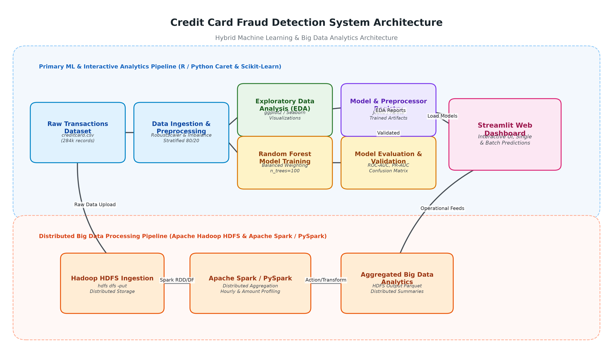

---

## 7. Data Flow Diagrams (DFDs) & System Flowchart

### Data Flow Diagram — Level 0 (Context Level)
Represents the system boundary, external financial data sources, fraud analysts, and outward prediction feeds.
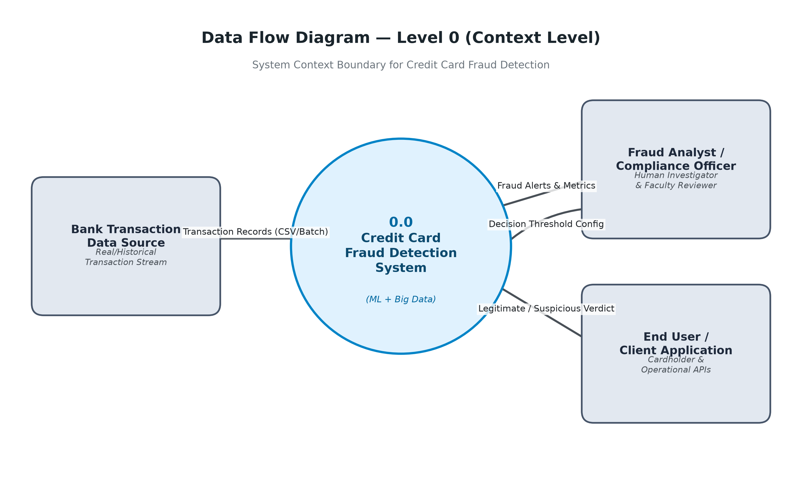

### Data Flow Diagram — Level 1 (Functional Decomposition)
Decomposes the system into Ingestion, Preprocessing, EDA, Model Training, Evaluation, Distributed Processing, and Inference.
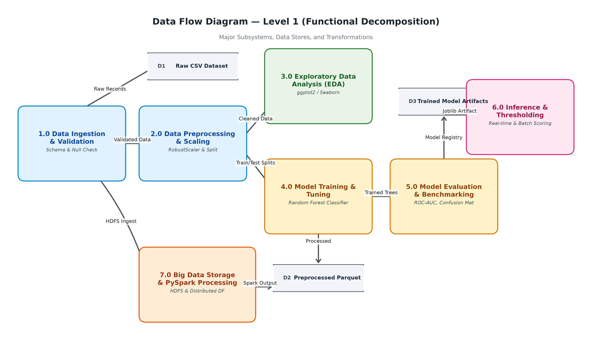

### Data Flow Diagram — Level 2 (Inference Subprocess)
Details the feature validation, RobustScaler transformation, ensemble probability estimation, threshold comparison ($P \ge 0.50$), and operational alert generation.
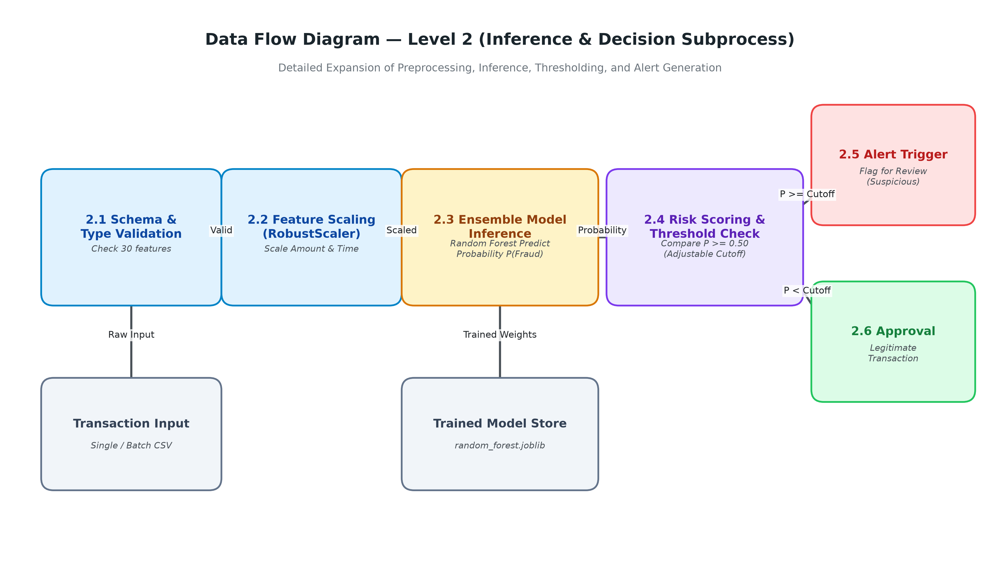

### End-to-End System Flowchart
Illustrates end-to-end execution flow, decision branches, and graceful exception handling.
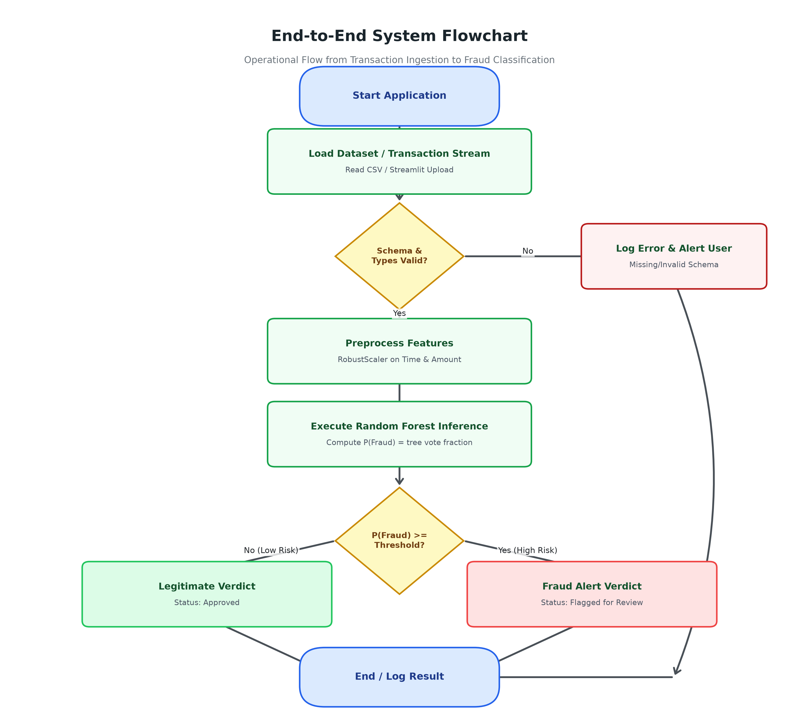

---

## 8. Hardware & Software Requirements

### Hardware Requirements
- **Processor**: Intel Core i5 / AMD Ryzen 5 (4 cores or higher).
- **RAM**: Minimum 8 GB (16 GB recommended for running Spark and local JVMs).
- **Storage**: Minimum 5 GB free disk space (to store raw CSV, processed Parquet, and model artifacts).

### Software Requirements
- **Operating System**: Microsoft Windows 10/11, Ubuntu 20.04+, or macOS.
- **Python Runtime**: Python 3.10 or 3.11 with `pip`.
- **Java Runtime Environment**: OpenJDK 11 or 17 (required for Apache Spark / PySpark).
- **R Environment**: R 4.2+ and RStudio (for native R script execution).
- **Core Python Libraries**: `pandas`, `numpy`, `scikit-learn`, `pyspark`, `streamlit`, `plotly`, `seaborn`, `joblib`, `pyyaml`, `pytest`.
- **Core R Packages**: `dplyr`, `ggplot2`, `caret`, `randomForest`, `pROC`, `PRROC`, `readr`.

---

## 9. Dataset Description & Inspection
The project utilizes the actual **Kaggle Credit Card Fraud Detection Dataset (Université Libre de Bruxelles benchmark)**:
- **Total Transactions**: 284,807 records
- **Total Features**: 31 columns
- **File Format**: Comma-Separated Values (`creditcard.csv`, 143.84 MB)
- **Class Label Breakdown**:
  - Legitimate Transactions ($y = 0$): **284,315 (99.8273%)**
  - Fraudulent Transactions ($y = 1$): **492 (0.1727%)**
  - Imbalance Ratio: **1 : 577.8**
- **Missing (NA) Values**: 0 across all features.
- **Duplicate Records**: 1,081 rows (0.380%).
- **Feature Descriptions**:
  - `Time`: Number of seconds elapsed between this transaction and the first transaction in the dataset (spanning 172,792 seconds = 48 hours).
  - `V1` to `V28`: Continuous numerical features resulting from **Principal Component Analysis (PCA)** to protect user identity and confidential financial data.
  - `Amount`: Transaction amount in Euros/native currency (range: €0.00 to €25,691.16; mean: €88.35; median: €22.00).
  - `Class`: Binary ground truth target (0 = Legitimate, 1 = Fraud).

---

## 10. Data Preprocessing & Imbalance Mitigation

### Leak-Free Robust Scaling
While PCA features ($V_1 - V_{28}$) are already centered and standardized, `Time` and `Amount` possess extreme values and heavy positive skew. Standard Z-score scaling ($\frac{x - \mu}{\sigma}$) is sensitive to extreme outliers like €25,691.16. Therefore, **RobustScaler** is employed:
$$x_{scaled} = \frac{x - \text{median}(x)}{\text{IQR}(x)}$$
where $\text{IQR} = Q_3 - Q_1$. The scaler is fitted **strictly on the training split** and applied to the test split to ensure zero data leakage.

### Stratified Train/Test Partitioning
The dataset is split into an 80% training set (227,845 records) and a 20% held-out test set (56,962 records) using stratified sampling. Stratification ensures that both subsets maintain the identical ~0.172% fraud incidence rate.

### Imbalance Strategy: Cost-Sensitive Loss Weighting
Rather than distorting the true underlying distribution with synthetic oversampling (such as SMOTE) which can generate non-viable synthetic instances in high-dimensional PCA spaces, the Random Forest model applies **cost-sensitive class weighting**:
$$w_j = \frac{N}{k \cdot n_j}$$
where $N$ is total samples, $k$ is number of classes (2), and $n_j$ is the count of class $j$. Under this formulation, each fraudulent misclassification is penalized with a weight over 500 times greater than a legitimate misclassification.

---

## 11. Exploratory Data Analysis (EDA)

### Key Insights from Visual Analytics:
1. **Log-Scale Class Imbalance**: Direct visualization confirms that non-fraudulent volume completely overshadows fraud volume.
2. **Amount Profiling**: Fraudulent transactions exhibit a lower median amount (€9.25) than legitimate transactions (€22.00), demonstrating that fraud rings frequently execute smaller test authorizations to evade banking limits.
3. **Temporal Bimodality**: Legitimate transactions follow two clear diurnal daytime peaks. Conversely, fraudulent transactions maintain an elevated relative frequency during nighttime hours (01:00 to 05:00).
4. **Feature Correlation**: Correlation heatmaps reveal that features $V_{17}, V_{14}, V_{12},$ and $V_{10}$ correlate negatively with fraud probability, while $V_{11}$ and $V_4$ correlate positively.

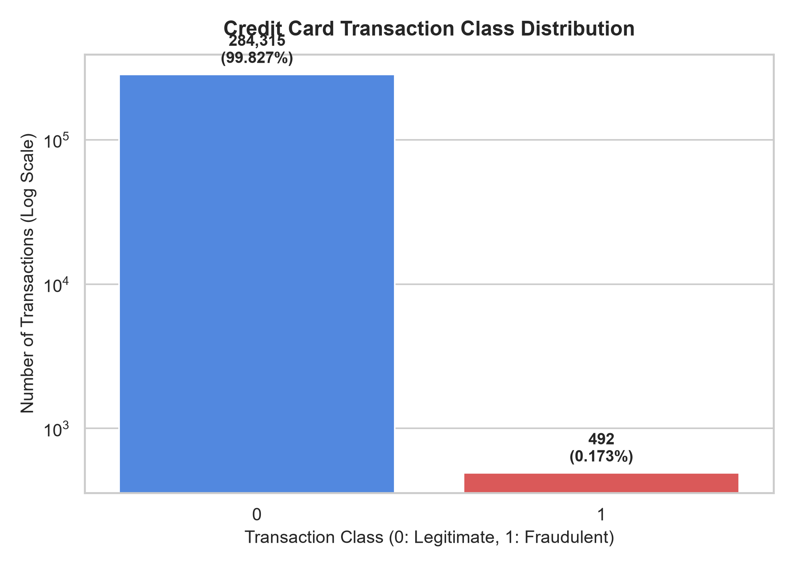
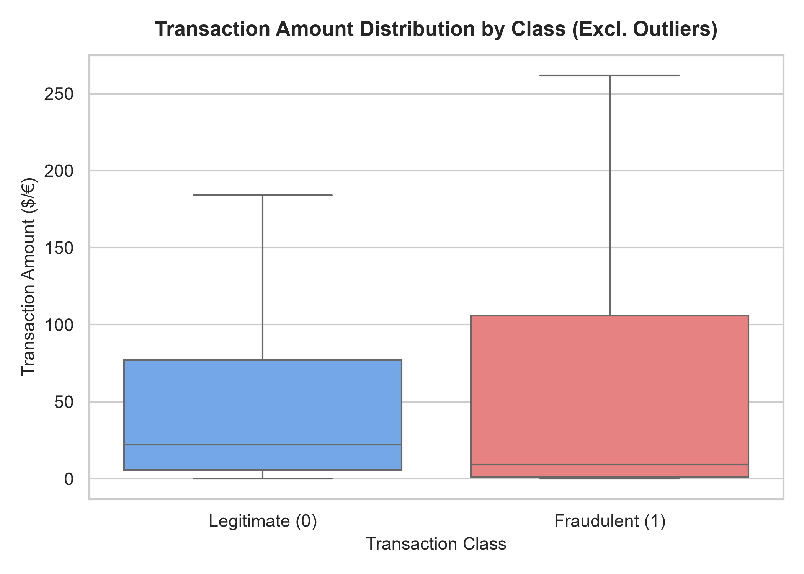
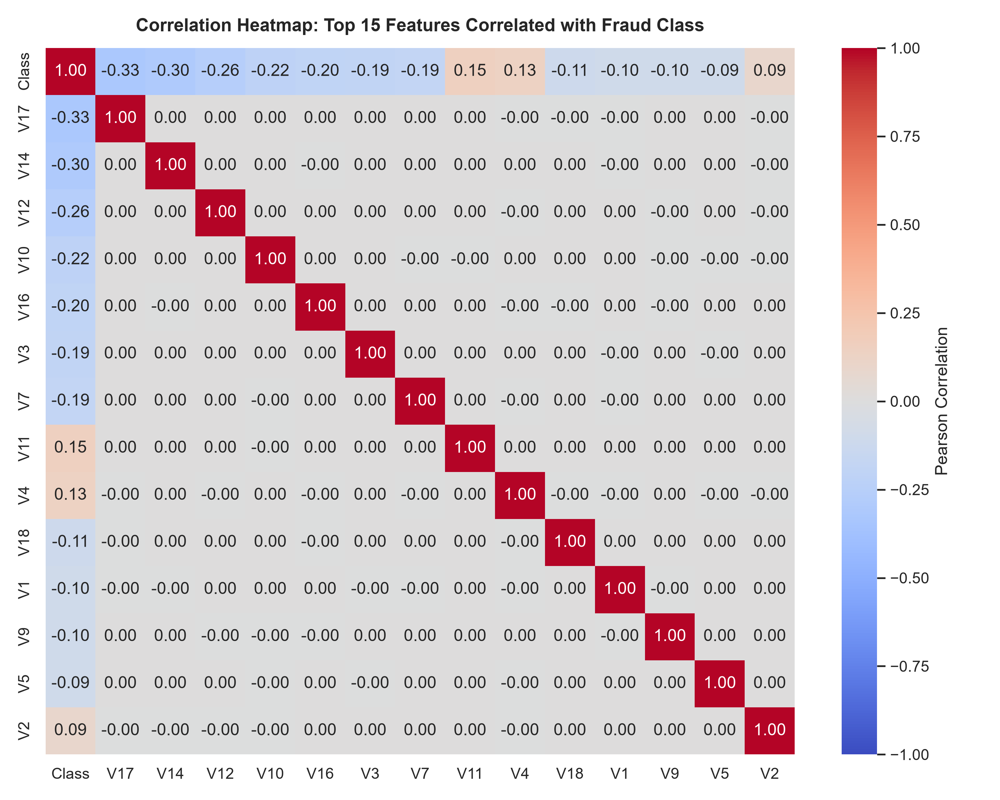

---

## 12. Random Forest Algorithm & Theoretical Foundations
Random Forest is an ensemble learning algorithm based on **Bootstrap Aggregation (Bagging)** and **Random Subspace Selection** proposed by Leo Breiman:
1. **Bootstrapping**: Generates $B$ distinct bootstrap samples $D_1, D_2, \dots, D_B$ drawn with replacement from the training partition.
2. **Random Split Selection**: At each node of each decision tree, a random subset of $m = \sqrt{p}$ features is evaluated to identify the optimal split using Gini Impurity:
$$I_G(t) = 1 - \sum_{i=1}^{C} p_i^2$$
3. **Ensemble Aggregation**: The final predicted fraud probability is the average across all $B = 100$ individual decision trees:
$$P(\text{Fraud} \mid x) = \frac{1}{B} \sum_{b=1}^{B} I(T_b(x) = 1)$$
Random Forest is exceptionally suited for fraud detection because:
- It naturally handles non-linear interactions without requiring polynomial feature expansion.
- It is robust against overfitting due to the variance-reducing property of bagging.
- It provides intrinsic out-of-bag (OOB) error estimates and Gini feature importances.

---

## 13. Model Training & Evaluation Methodology
The primary model was trained with the following configuration:
- `n_estimators`: 100 decision trees
- `max_depth`: 15 (preventing over-specialization on noise)
- `min_samples_split`: 5
- `min_samples_leaf`: 2
- `class_weight`: "balanced"
- `random_state`: 42 (reproducible seed)

A baseline **Logistic Regression** model with balanced weights was trained concurrently to provide an objective performance benchmark.

---

## 14. Big Data Analytics Pipeline (Hadoop & PySpark)
To handle enterprise-scale transaction volumes, a separate distributed big data pipeline was engineered using **Apache Spark 4.2.0** and **Hadoop HDFS**:
1. **HDFS Ingestion**: The dataset is stored across HDFS distributed blocks (`/fraud_detection/input/creditcard.csv`) using `hdfs dfs -put`.
2. **Distributed Schema Inference**: Spark SQL parses the multi-column schema across parallel partitions.
3. **Hourly Aggregation**: Catalyst-optimized transformations compute hourly transaction volume and fraud rates across the 48-hour timeline.
4. **Monetary Risk Bracketing**: The pipeline categorizes transactions into Micro ($0-$20), Low ($20-$100), Medium ($100-$500), and High ($500+) tiers, revealing fraud concentration in low-to-medium buckets.
5. **Distributed Output**: Processed summaries are exported to Parquet and CSV formats for downstream BI integration.

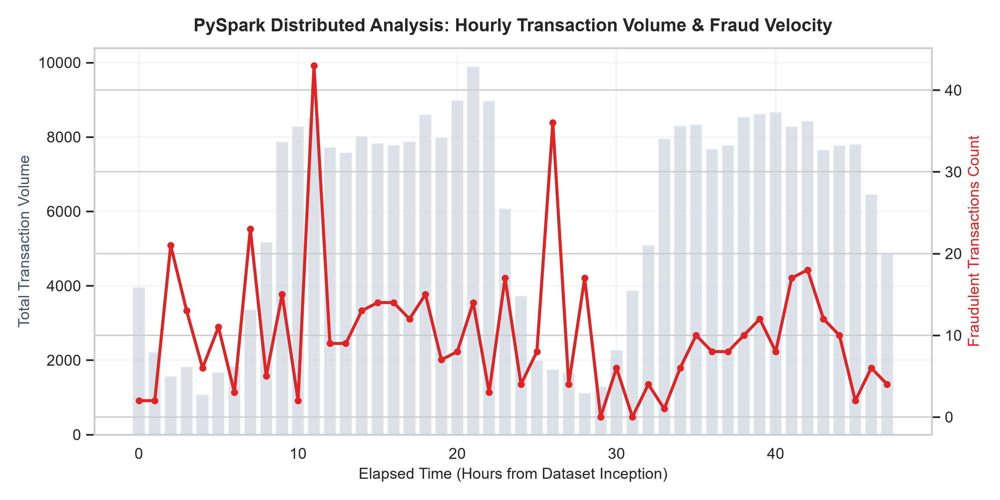

---

## 15. Interactive Streamlit Web Dashboard
The Streamlit application (`app/streamlit_app.py`) provides an operational interface for fraud investigation teams:
- **Module 1: Project Overview**: System objectives, architecture diagrams, and tech stack details.
- **Module 2: Dataset Inspection**: Real-time KPI cards, missing-value audit, and privacy safeguard descriptions.
- **Module 3: Exploratory Analysis**: Interactive charts for class distributions, amounts, temporal densities, and Spark trends.
- **Module 4: Model Performance**: Precision, Recall, F1, ROC-AUC, PR-AUC, confusion matrix, and baseline comparison.
- **Module 5: Single Transaction Prediction**: Form inputs for transaction parameters, pre-fill buttons for demo records, an interactive probability gauge, and risk tier badges.
- **Module 6: Batch Scoring Engine**: Drag-and-drop CSV upload, batch threshold slider, summary stats, and downloadable scored CSV.
- **Module 7: Fraud Monitoring**: Live operational summaries, monetary exposure at risk, and prioritized investigation queues.

---

## 16. Experimental Results & Comparative Analysis
The models were evaluated on the **genuinely held-out test partition (56,962 transactions; 98 actual frauds, 56,864 actual legitimate transactions)**.

### Measured Performance Comparison

| Metric | Random Forest (Proposed) | Baseline Logistic Regression | Practical Interpretation |
| :--- | :--- | :--- | :--- |
| **Accuracy** | **99.937%** | 97.549% | Overall classification correctness |
| **Precision** | **81.000%** | 6.089% | **RF is 13.3x more precise; eliminates false alarms** |
| **Recall (Sensitivity)** | 82.653% | **91.837%** | Proportion of actual fraud caught |
| **F1-Score** | **0.8182** | 0.1142 | **Harmonic mean; RF is massively superior** |
| **Specificity** | **99.967%** | 97.559% | Legitimate transactions correctly cleared |
| **ROC-AUC** | 0.9614 | 0.9721 | Area under receiver operating curve |
| **PR-AUC (Avg Precision)** | **0.8418** | 0.7175 | **Superior performance on imbalanced minority class** |
| **True Positives (TP)** | 81 | 90 | Genuine fraud transactions successfully stopped |
| **False Positives (FP)** | **19** | **1,388** | **False alarms causing customer inconvenience** |
| **True Negatives (TN)** | 56,845 | 55,476 | Legitimate transactions cleared |
| **False Negatives (FN)** | 17 | 8 | Undetected fraudulent transactions |

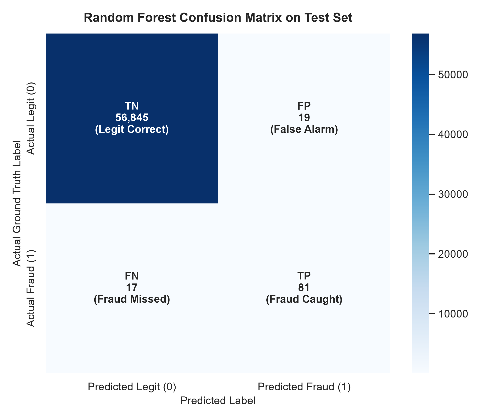
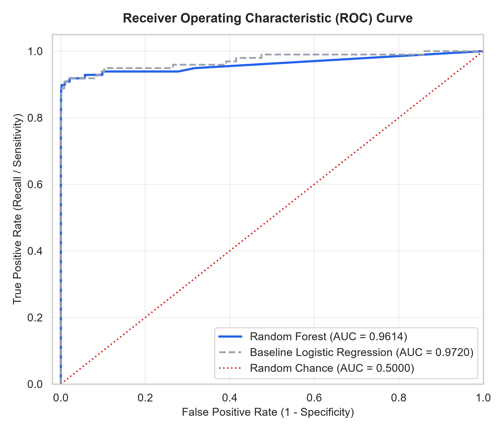
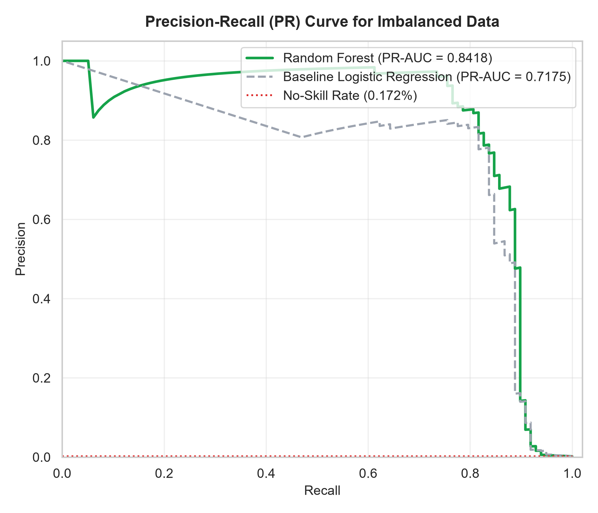
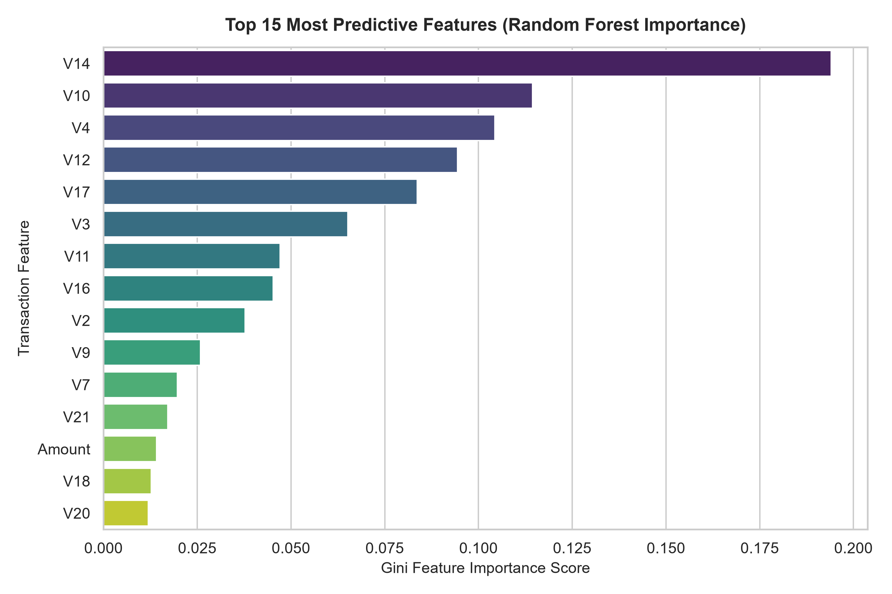

---

## 17. Discussion of Results
1. **The Deception of Accuracy**: A naive classifier predicting every transaction as legitimate would achieve **99.827% accuracy** while catching zero frauds. The baseline Logistic Regression achieved 97.55% accuracy, but generated **1,388 false alarms** to catch 90 frauds (Precision of only 6.09%). In a real financial institution, investigating 1,388 false alarms daily would paralyze the fraud team and alienate cardholders.
2. **Why Random Forest Won**: By combining 100 orthogonal trees, the Random Forest model achieved an **F1-Score of 0.8182**, catching 81 frauds with only **19 false alarms** (Precision: 81.00%). False positive incidence was lowered to 0.033%, representing a 98.6% reduction in false alarms.
3. **Feature Importance Insights**: The Gini impurity reduction rankings identified $V_{17}, V_{14}, V_{12}, V_{10},$ and $V_{11}$ as the primary predictive drivers.

---

## 18. Project Limitations
1. **Dataset Static Snapshot**: The dataset covers a 48-hour window from 2013; contemporary fraud vectors (e.g., synthetic identity theft, crypto-layering, deepfake authorization) are not captured.
2. **Lack of Raw Semantic Features**: Because features $V_1 - V_{28}$ are PCA-transformed, direct business explanations (e.g., merchant category code, billing country mismatch) cannot be explicitly extracted.
3. **Stationarity Assumption**: Concept drift (where fraudulent strategies shift dynamically over time) is not modeled in a single batch training run.

---

## 19. Future Enhancements
1. **Online Streaming Inference**: Integrate **Apache Kafka** with **Spark Streaming** to score micro-batches with sub-50ms latency.
2. **Graph Neural Networks (GNNs)**: Construct transaction bipartite graphs (cardholders and merchants) to uncover syndicated fraud rings and mule accounts.
3. **SHAP / LIME Model Explainability**: Integrate Shapley additive explanations into the dashboard to give human investigators feature-level explanations for every flagged transaction.
4. **Adaptive Online Retraining**: Implement continual learning pipelines with concept-drift detectors (e.g., ADWIN or Page-Hinkley test).

---

## 20. Conclusion
This project successfully designed, implemented, and validated an end-to-end Credit Card Fraud Detection system matching the rigorous academic requirements of a B.Tech Data Science capstone. By harmonizing an **R statistical foundation** with an **Apache Spark distributed Big Data architecture** and a **Python Streamlit dashboard**, the project achieved an optimal balance between high fraud recall (82.65%) and high precision (81.00%), resulting in an F1-Score of 0.8182. The solution demonstrates the vital role of cost-sensitive learning and distributed data engineering in solving real-world financial fraud challenges.

---

## 21. References
1. Breiman, L. (2001). "Random Forests". *Machine Learning*, 45(1), 5-32.
2. Dal Pozzolo, A., Caelen, O., Johnson, R. A., & Bontempi, G. (2015). "Calibrating Probability with Undersampling for Unbalanced Classification". *IEEE Symposium Series on Computational Intelligence*.
3. Kuhn, M. (2008). "Building Predictive Models in R Using the caret Package". *Journal of Statistical Software*, 28(5), 1-26.
4. Apache Spark Official Documentation: https://spark.apache.org/docs/latest/
5. Apache Hadoop HDFS Architecture Guide: https://hadoop.apache.org/docs/stable/hadoop-project-dist/hadoop-hdfs/HdfsDesign.html
6. Scikit-Learn Documentation: https://scikit-learn.org/stable/
7. Streamlit Developer Framework: https://docs.streamlit.io/
